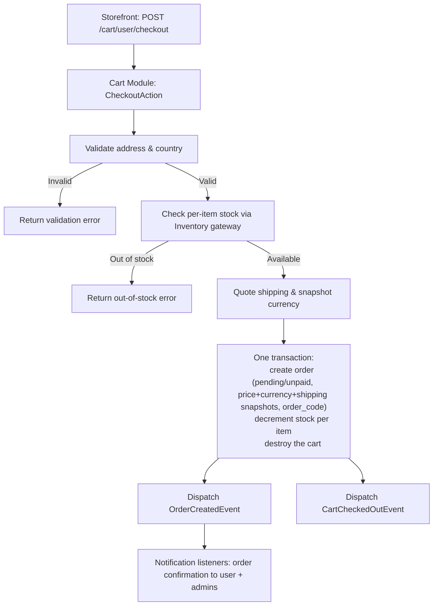

# Order flow

Order placement is driven by the Cart module's checkout: it validates the
cart, then creates the order and decrements stock inside a single
database transaction.

The fresh order is `pending` / `unpaid` with a public `order_code` and an
`expires_at` deadline (30 minutes). From there:

- **Payment** — the storefront starts a payment against the `order_code`;
  settlement marks the order `paid` (see
  [payment flow](/architecture/flows/payment-flow)).
- **Expiry** — a scheduled command (`order:cancel-expired`) cancels
  expired unpaid orders and dispatches `OrderCancelledEvent`, so the
  customer and admins are notified.
- **Fulfilment** — admins move the order through the
  [state machine](/architecture/flows/order-state-machine); shipment
  updates in the Shipping module mirror `shipped`/`delivered` onto the
  order automatically.
