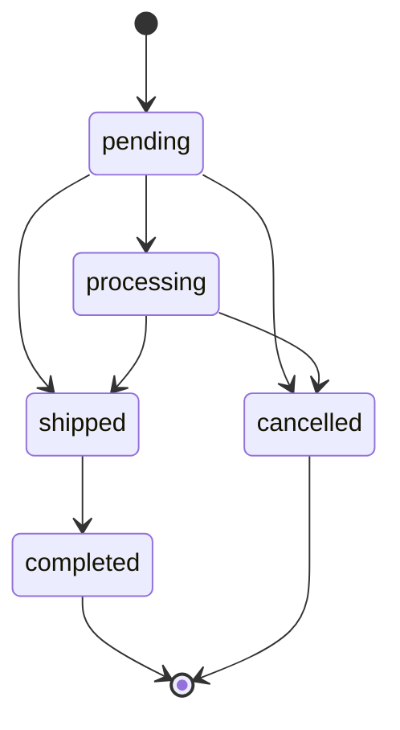
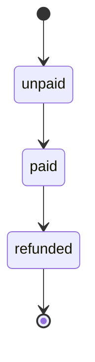

# Order state machine

Every order carries two independent status axes, each a guarded state
machine — no order jumps states implicitly.

## Fulfilment status

New orders start at `pending`. Cancellation happens either by the
customer or by the scheduled expiry command (unpaid orders past their
`expires_at`).

## Payment status

A settled payment flips the order to `paid` (see
[payment flow](/architecture/flows/payment-flow)); refunds are applied by
admins.

## Shipping mirrors onto the order

The Shipping module keeps one shipment per order and mirrors its
lifecycle: when a shipment reaches `shipped` the order gateway marks the
order `shipped`, and when it reaches `delivered` the order is marked
`completed` (see [Shipping](/backend/shipping)).
