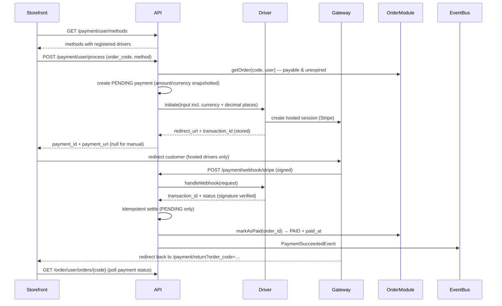

# Payment flow

Checkout and payment are two steps: checkout creates an UNPAID order
(expiring in 30 minutes), then a payment is started against its public
`order_code`. Payments are **synchronous by default and async-capable** —
hosted gateways settle through signed webhooks.

## Drivers

Payment methods are a driver registry: `PaymentMethodEnum` supplies the
case, `config('payment.drivers')` maps it to a `PaymentDriverInterface`
implementation, and `PaymentDriverManager` resolves it. A method is
offerable only when it has a registered driver, the driver's credentials
are configured, **and** an admin has activated it in the payment-methods
screen (`payment_methods.is_active`, with `sort_order` controlling the
checkout picker's order) — `GET /payment/user/methods` returns exactly
that set and is the storefront's source of truth. All hosted drivers
follow the same shape: redirect the customer to a gateway-hosted page,
settle exclusively through the signature-verified webhook, and bridge
the gateway's transaction reference to the stored `transaction_id`.

| Method        | Driver                     | Flow                                                                     |
| ------------- | -------------------------- | ------------------------------------------------------------------------ |
| `manual`      | `ManualPaymentDriver`      | No hosted checkout; an admin settles it (`PATCH /admin/payments/{id}`).  |
| `stripe`      | `StripePaymentDriver`      | Hosted Checkout redirect; settled by signed webhook.                     |
| `paypal`      | `PaypalPaymentDriver`      | Orders v2 approve-redirect; capture server-side on webhook.              |
| `adyen`       | `AdyenPaymentDriver`       | Pay by Link redirect; HMAC-verified standard webhook (auto-capture).     |
| `mercadopago` | `MercadopagoPaymentDriver` | Checkout Pro preference redirect (LatAm); payment re-fetched on webhook. |
| `nowpayments` | `NowpaymentsPaymentDriver` | Crypto invoice; settles only when funds land (`finished` IPN status).    |
| `checkoutcom` | `CheckoutcomPaymentDriver` | Payment Links redirect; settles on `payment_captured` (auto-capture).    |
| `razorpay`    | `RazorpayPaymentDriver`    | Payment Links redirect (India); settles on `payment_link.paid`.          |

## Sequence

The customer redirect is UX-only — settlement happens exclusively in the
webhook path, which is idempotent (replayed events for settled payments
are acked as no-ops).

## Stripe specifics

- `initiate` creates a Checkout Session (`mode=payment`, single
  `price_data` line item in minor units derived from the order currency's
  decimal places, `{order_code}`-templated success/cancel URLs). The
  session id (`cs_...`) is stored as the `transaction_id`.
- `handleWebhook` verifies `Stripe-Signature` (HMAC over the raw body)
  and maps: `checkout.session.completed` with `payment_status=paid` and
  `async_payment_succeeded` → success; `async_payment_failed`/`expired`
  → failed; anything else is rejected. A completed-but-unpaid session
  (deferred payment methods) is rejected too, so the payment stays
  PENDING until its terminal event.

The Stripe driver is configured in the backend's `.env`:

| Variable                | Description                                                          |
| ----------------------- | -------------------------------------------------------------------- |
| `STRIPE_SECRET`         | Stripe API secret key; without it the `stripe` method is not offered |
| `STRIPE_WEBHOOK_SECRET` | Signing secret for `POST /api/v1/payment/webhook/stripe`             |
| `STRIPE_SUCCESS_URL`    | Storefront return page; `{order_code}` is templated in               |
| `STRIPE_CANCEL_URL`     | Cancelled-checkout return page                                       |

## The other gateway drivers

Every additional gateway follows the same contract — credentials in the
backend's `.env`, webhook at `POST /api/v1/payment/webhook/{driver}`,
return/pending/cancel URLs templating `{order_code}` onto the
storefront's `/payment/return` page. Non-terminal webhook events are
rejected so the payment stays PENDING until a terminal one lands.

| Driver        | Credentials                                                                     | Webhook verification                           | Settles on                                                                            |
| ------------- | ------------------------------------------------------------------------------- | ---------------------------------------------- | ------------------------------------------------------------------------------------- |
| `paypal`      | `PAYPAL_MODE`, `PAYPAL_CLIENT_ID`/`_SECRET`, `PAYPAL_WEBHOOK_ID`                | verify-webhook-signature API call              | `CHECKOUT.ORDER.APPROVED` triggers a server-side capture; `PAYMENT.CAPTURE.COMPLETED` |
| `adyen`       | `ADYEN_ENV`, `ADYEN_API_KEY`, `ADYEN_MERCHANT_ACCOUNT`, `ADYEN_HMAC_KEY`        | Standard-webhook HMAC                          | `AUTHORISATION` with success — auto-capture accounts only                             |
| `mercadopago` | `MERCADOPAGO_ACCESS_TOKEN`, `MERCADOPAGO_WEBHOOK_SECRET`, `MERCADOPAGO_SANDBOX` | `x-signature` HMAC; payment re-fetched via API | `approved` only — `pending`/`in_process` (Pix, Boleto) stay PENDING                   |
| `nowpayments` | `NOWPAYMENTS_ENV`, `NOWPAYMENTS_API_KEY`, `NOWPAYMENTS_IPN_SECRET`              | `x-nowpayments-sig` HMAC                       | `finished` only — crypto waiting/confirming states stay PENDING                       |
| `checkoutcom` | `CHECKOUTCOM_ENV`, `CHECKOUTCOM_SECRET_KEY`, `CHECKOUTCOM_WEBHOOK_SECRET`       | `cko-signature` HMAC                           | `payment_captured` — `payment_approved` (authorised, not captured) is rejected        |
| `razorpay`    | `RAZORPAY_KEY_ID`/`_KEY_SECRET`, `RAZORPAY_WEBHOOK_SECRET`                      | `x-razorpay-signature` HMAC                    | `payment_link.paid`; `payment_link.cancelled` fails                                   |

Each driver also takes its return/cancel URL variables
(`PAYPAL_RETURN_URL`/`_CANCEL_URL`, `ADYEN_RETURN_URL`,
`MERCADOPAGO_SUCCESS_URL`/`_PENDING_URL`/`_FAILURE_URL`,
`NOWPAYMENTS_SUCCESS_URL`/`_CANCEL_URL`, `CHECKOUTCOM_RETURN_URL`,
`RAZORPAY_RETURN_URL`) — all `{order_code}`-templated like Stripe's.

## Adding a payment driver

1. Add the case to `PaymentMethodEnum` (values are public API).
2. Implement `PaymentDriverInterface` (`initiate` + `handleWebhook`) under
   `Modules/Payment/app/Gateways/Drivers/`; verify the webhook signature
   inside `handleWebhook` and return the stored `transaction_id`.
3. Register it under its enum value in
   `Modules/Payment/config/payment.php` plus a config block for its
   env-driven credentials.
4. Point the gateway's webhook at `POST /api/v1/payment/webhook/{driver}`
   — `HandleWebhookAction` handles matching, idempotent settling, order
   `markAsPaid` and events generically.
5. Sync the storefront: extend `ApiPaymentMethod` in `lib/api/types.ts`
   and add checkout labels under `payment.methods.*` in
   `messages/{en,fa}/checkout/checkout.json`.
6. Cover the driver with unit tests (signature + event mapping).

Every gateway added this way shows up in the admin's payment-methods
screen once configured, disabled by default — flip it active there to
offer it at checkout.
